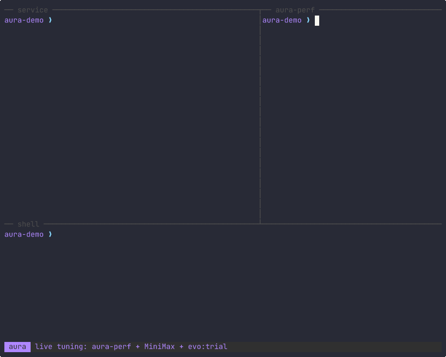

# Aura

AI-native Lisp — 代码自己进化。

The API is not stable. These commands install the rolling nightly built from `main`.

## Watch a running service retune itself

一个真实的 HTTP 服务在给注册名单去重。aura-perf 发现 `dedupe` 占了每个请求 98% 的时间；MiniMax 提出改法，先在隔离的子世界线里用真实请求试跑：第一版没通过，回滚；第二版输出一致且更快，直接热替换进正在跑的进程，不重启。

A real HTTP service dedupes sign-up lists. [aura-perf](https://github.com/cybrid-systems/aura-perf) finds `dedupe` is 98% of each request. MiniMax proposes a fix, `evo:trial` replays real requests in a child worldline: the first proposal is rolled back, the second is kept with `mutate :rebind` — same process, no restart.



| Real run, Aura `53e2ae6f`, default sandbox | Before | After |
|---|---:|---:|
| Requests/s | 1.6 | 69.6 |
| p50 | 462 ms | 14 ms |
| Whole request (aura-perf) | 430 ms | 12 ms |

894 requests, 0 failures, 0 restarts. Replay it with [asciinema](https://asciinema.org) from [`docs/assets/live-tune.cast`](docs/assets/live-tune.cast), or run it yourself: [`examples/live-tune`](examples/live-tune).

## Install

Linux, x86_64 or arm64:

```sh
curl -fsSL https://raw.githubusercontent.com/cybrid-systems/aura/main/install.sh | sh
```

Put `~/.local/bin` on `PATH`. Nightly is replaced on each push to `main`. To reproduce a run, pin `ghcr.io/cybrid-systems/aura:<sha9>` or the image digest. More detail: [docs/install.md](docs/install.md).

```sh
docker run --rm -v "$PWD:/w" -w /w ghcr.io/cybrid-systems/aura:nightly main.aura
```

Supported hosts are Ubuntu 24.04, Debian 12, Rocky Linux 9, and openEuler 24.03 LTS SP4, each on x86_64 and arm64. macOS, Windows, and other Linux distributions are not supported.

## Quick start

```sh
aura demo
```

An offline version without a network or model: fixed candidates, KEEP or ROLLBACK, live source after each step.

The same program is a project you can edit:

```sh
aura new evolve demo   # the same program as a project
cd demo
aura run
aura test
```

`aura demo agent` shows the two-role version (a proposer and a checker).
`aura new` (`app`, `evolve`, or `agent`) writes a template from this repository. The evolve-strategy kit is a separate project: [aura-starter-kits](https://github.com/cybrid-systems/aura-starter-kits).

[Getting started](docs/getting-started.md) · [Editor support and the REPL](docs/editor.md)
