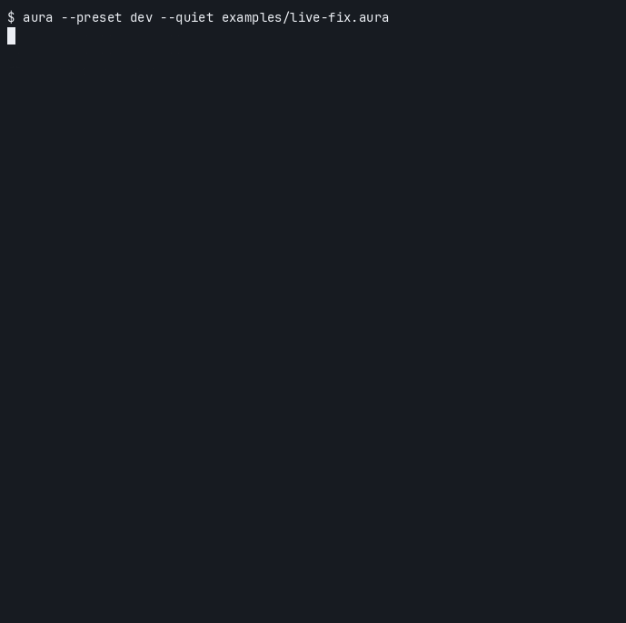

# Aura

Let AI rewrite your running program — safely. Bad changes are undone instantly; good ones go live without a restart.



[cast](docs/assets/live-fix.cast)

## Install

```sh
curl -fsSL https://raw.githubusercontent.com/cybrid-systems/aura/main/install.sh | sh
```

## Try

```sh
aura --preset dev --quiet examples/live-fix.aura
```

[Getting started](docs/getting-started.md) · [Install](docs/install.md) · [Editor](docs/editor.md)

<sub>The API is not stable. Nightly is the rolling build from `main`. Supported hosts: Ubuntu 24.04, Debian 12, Rocky Linux 9, and openEuler 24.03 LTS SP4, each on x86_64 and arm64.</sub>
